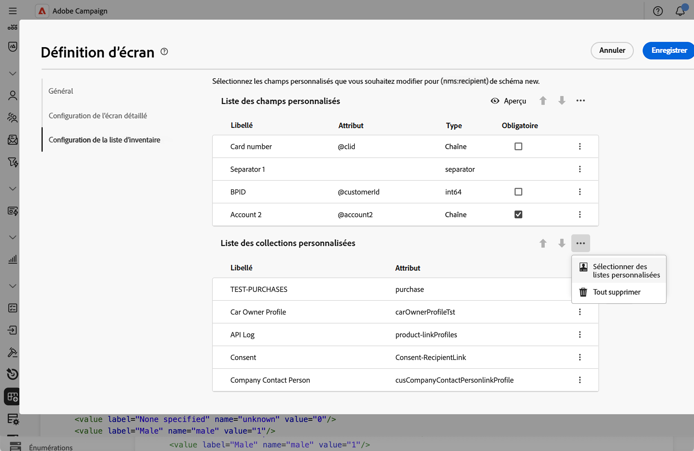
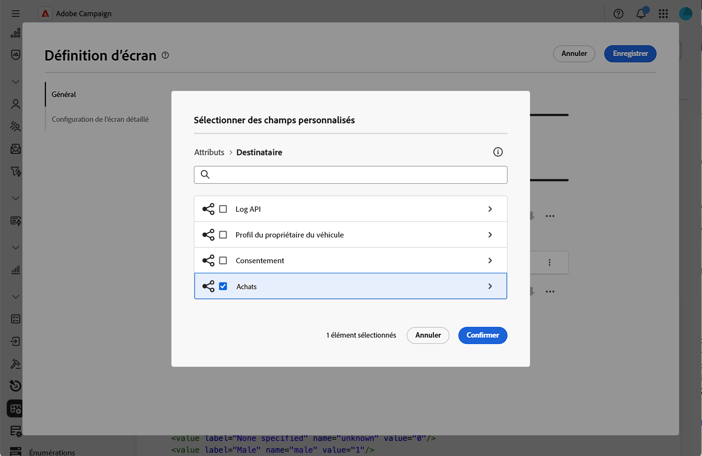
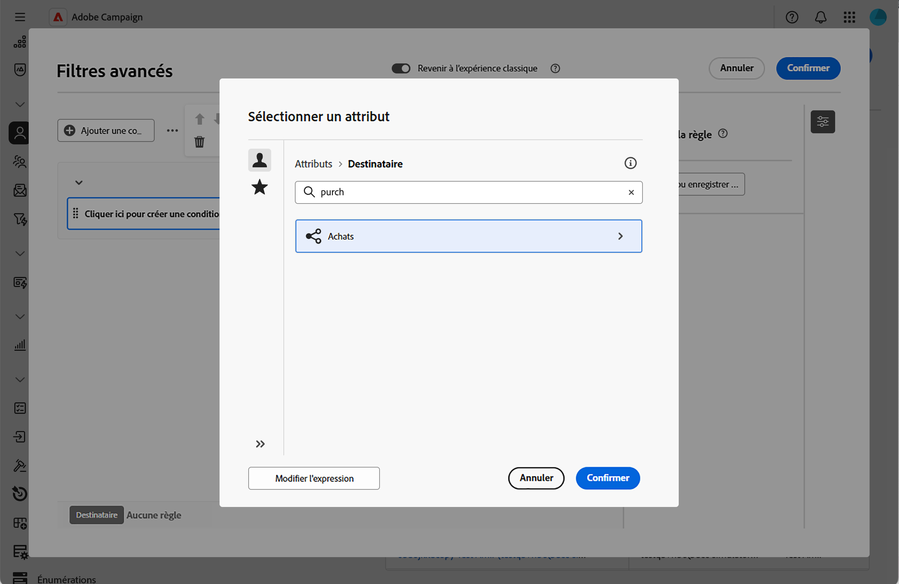
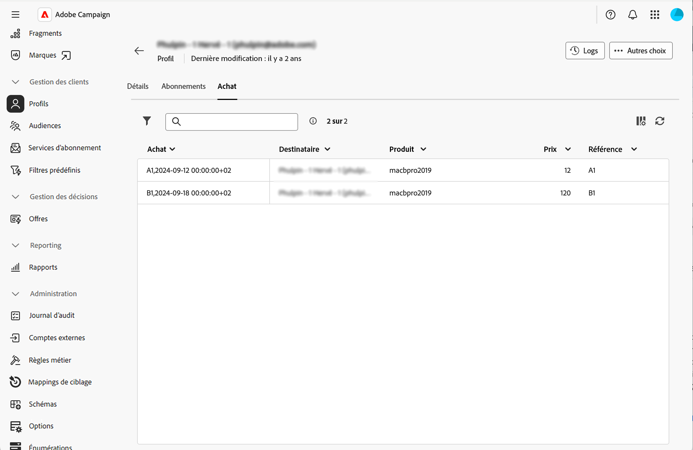

# Ajout de listes de collections {#collection-lists}

La section **Liste des listes personnalisées** vous permet de définir des liens de collection, tels que les achats. Les données associées sont alors affichées sur les écrans des profils via un onglet dédié.

Pour plus d’informations sur la définition d’écran et la façon d’y accéder, consultez la section [Accéder à la définition d’écran](schemas-browse-access.md#screen-def).

>[!NOTE]
>
>Actuellement, cette fonctionnalité n’est disponible que pour le schéma Destinataires.

Pour ajouter des listes de collections :

1. Accédez au menu **[!UICONTROL Schémas]** et recherchez les schémas modifiables à l’aide des filtres.

1. Sélectionnez le nom du schéma dans la liste pour l’ouvrir et cliquez sur le bouton **[!UICONTROL Modification d’écran]** dans la vue des détails du schéma pour accéder à la définition d’écran.

1. Cliquez sur l’icône représentant des points de suspension et choisissez **[!UICONTROL Sélectionner des listes personnalisées]**.

   

1. Sélectionnez l’une des listes personnalisées disponibles, par exemple les achats, puis cliquez sur **[!UICONTROL Confirmer]**.

   

1. Accédez au menu **Profils** et filtrez les profils qui ont effectué des achats.

   

1. Cliquez sur un profil. Vous remarquerez que le nouvel onglet s’affiche. Vous pouvez ajouter d’autres colonnes si nécessaire.

   
