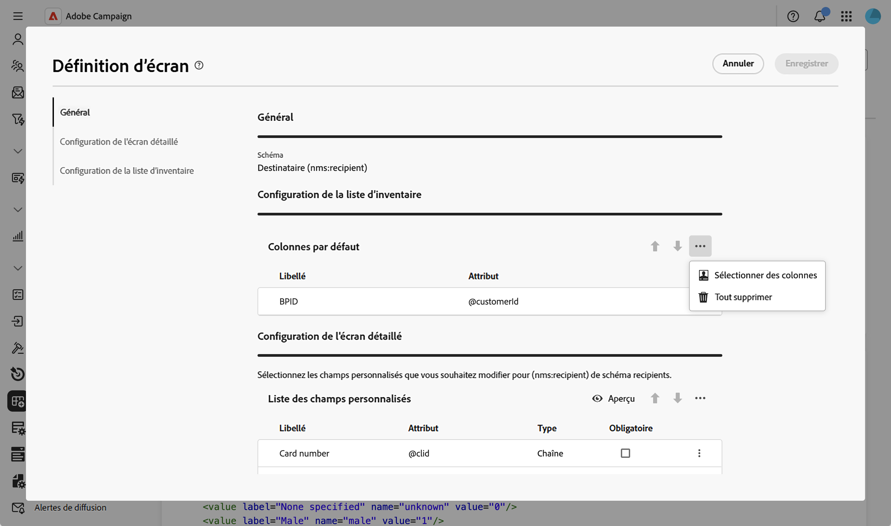
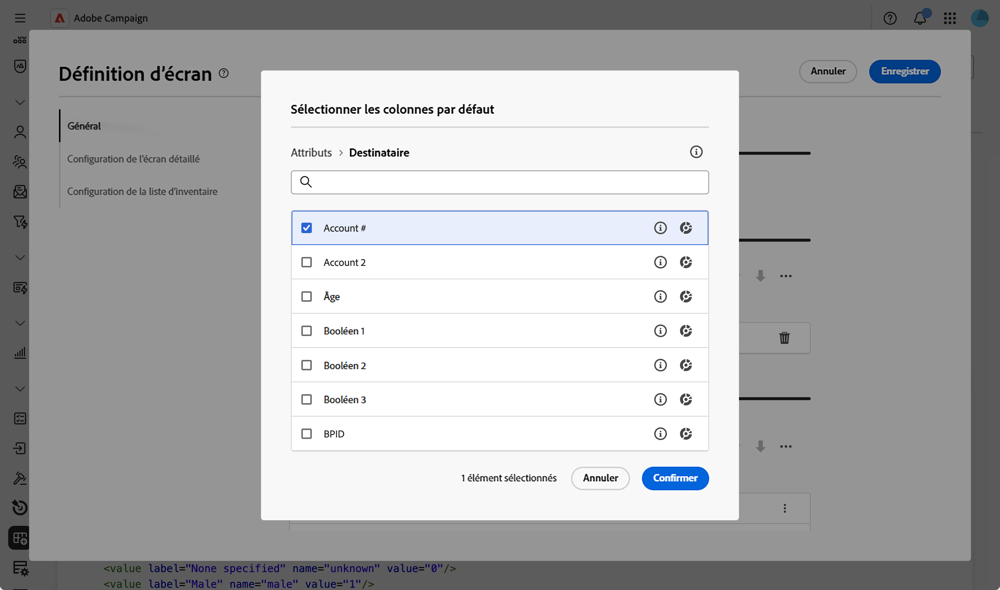
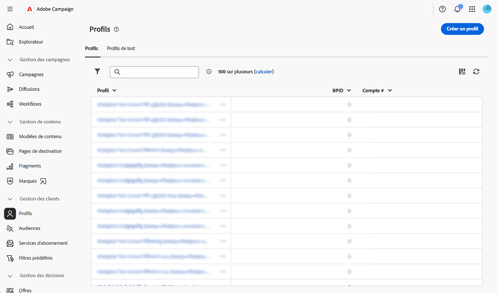

# Configurer des colonnes de listes {#list-columns}

>[!CONTEXTUALHELP]
>id="acw_schema_inventory_list_configuration"
>title="Configuration de la liste d’inventaire"
>abstract="Configurez les colonnes affichées par défaut dans les vues de liste. Chaque colonne affiche son libellé et l’attribut correspondant. Ajoutez des filtres personnalisés pour afficher les champs de filtre d’accès rapide dans le volet Filtres de la vue Liste."
>additional-url="https://experienceleague.adobe.com/docs/campaign-web/v8/conf/schemas/schemas-custom-filters.html?lang=fr" text="Ajouter des filtres personnalisés"

La section **[!UICONTROL Configuration de la liste d’inventaire]** vous permet de configurer les colonnes affichées par défaut dans les vues Liste. Chaque colonne affiche son libellé et l’attribut correspondant.

Pour plus d’informations sur la définition d’écran et la façon d’y accéder, consultez la section [Accéder à la définition d’écran](schemas-browse-access.md#screen-def).

Pour ajouter de nouvelles colonnes à la liste par défaut, procédez comme suit :

1. Accédez au menu **[!UICONTROL Schémas]** et recherchez les schémas modifiables à l’aide des filtres.

1. Sélectionnez le nom du schéma dans la liste pour l’ouvrir et cliquez sur le bouton **[!UICONTROL Modification d’écran]** dans la vue des détails du schéma pour accéder à la définition d’écran.

1. Cliquez sur l’icône représentant des points de suspension (trois points).
1. Choisissez **[!UICONTROL Sélectionner des colonnes]**.
   

1. Sélectionnez les attributs à afficher dans les vues de liste et confirmez.

   

1. Accédez au menu **Profils** pour accéder à la vue Liste des profils. Vous remarquerez que les nouveaux onglets s’affichent. Vous pouvez ajouter d’autres colonnes si nécessaire.

   

>[!NOTE]
>
>Vous pouvez également ajouter des champs de filtre d’accès rapide dans le volet Filtres de la vue Liste. Pour plus d’informations, consultez [Ajouter des filtres personnalisés](schemas-custom-filters.md).
