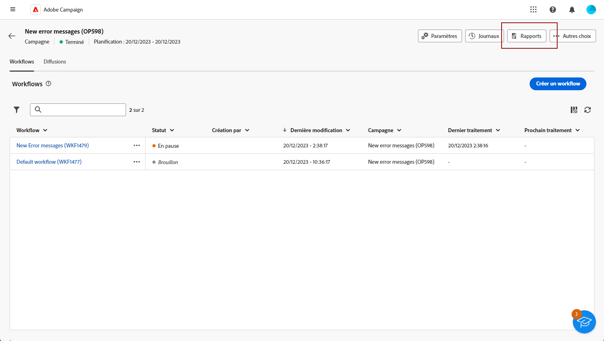
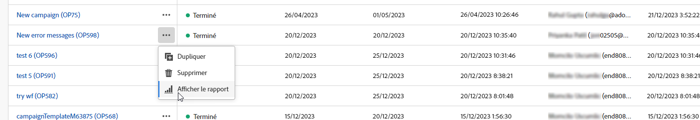
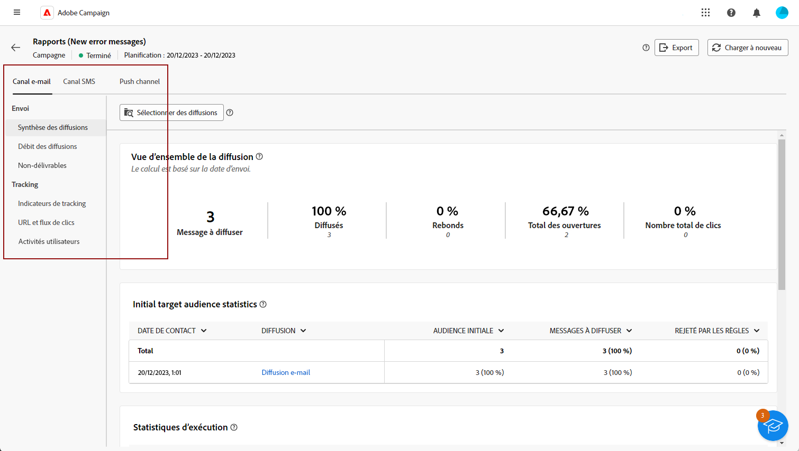
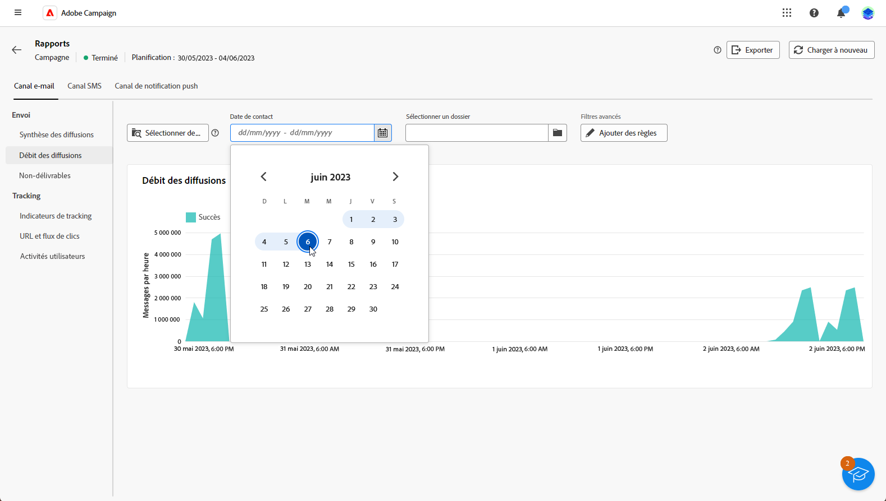

# Prise en main des rapports de campagne {#campaign-reports}

Les **rapports de campagne** fournissent une vue d’ensemble de votre **campagne**, avec toutes les informations pertinentes concernant les diffusions incluses. Ces rapports proposent une analyse détaillée des performances de chaque diffusion, pour chaque canal : taux de succès, engagement de l’audience et autres mesures clés. Ils vous aident à évaluer l’efficacité globale et l’impact de votre campagne.

La liste complète des rapports et mesures associées pour chaque canal est disponible dans les pages suivantes :

* [Canal de campagne par e-mail](campaign-reports-email.md)
* [Canal de campagne par SMS](campaign-reports-sms.md)
* [Canal de campagne par notification push](campaign-reports-push.md)
* [Canal de campagne par courrier](campaign-reports-direct-mail.md)

## Gérer votre tableau de bord des rapports {#manage-reports}

Pour accéder à vos rapports de campagne et les gérer, procédez comme suit :

1. Accédez au menu **[!UICONTROL Campagnes]**, puis cliquez sur le bouton **Rapports** dans le tableau de bord de votre campagne.

   {zoomable="yes"}

   Vous pouvez également utiliser les trois points **Autres actions** en regard du nom de la campagne dans la liste des campagnes et sélectionner **[!UICONTROL Afficher le rapport]**.

   {zoomable="yes"}

1. Dans le menu de gauche, sélectionnez un rapport dans la liste et naviguez dans les onglets pour afficher les données de chaque canal.

   {zoomable="yes"}

1. Dans votre tableau de bord, cliquez sur **[!UICONTROL Sélectionner des diffusions]** pour cibler une diffusion spécifique incluse dans votre campagne.

1. Dans le menu **[!UICONTROL Débit de diffusion]**, choisissez une **Heure de début** et une **[!UICONTROL Heure de fin]** pour vous focaliser sur des données spécifiques.

   {zoomable="yes"}

1. Dans le champ **[!UICONTROL Sélectionner un dossier]**, choisissez si vous souhaitez cibler des diffusions ou des campagnes d’un dossier spécifique.

   Vous pouvez également sélectionner **[!UICONTROL Ajouter des règles]** pour créer des requêtes afin de mieux filtrer les données de rapport. [Découvrir comment utiliser le concepteur de requête](../query/query-modeler-overview.md)

   {zoomable="yes"}

1. Dans **[!UICONTROL URL et flux de clics]**, choisissez les **[!UICONTROL Liens les plus visités]** ou la **[!UICONTROL Période]**.

   Les options **[!UICONTROL Afficher par]** permettent de filtrer sur des URL, des libellés ou des catégories.

## Rapports pour le canal LINE {#line-reports}

Les rapports disponibles pour le canal LINE sont décrits ci-dessous.

### Synthèse des diffusions {#line-delivery-summary}

>[!CONTEXTUALHELP]
>id="acw_campaign_reporting_line_deliveries_overview"
>title="Vue d’ensemble de la diffusion"
>abstract="Affichez les messages à diffuser, les messages diffusés et les erreurs de diffusion pour LINE."

Le rapport **[!UICONTROL Présentation des diffusions]** affiche les messages à diffuser, les messages diffusés et les erreurs de diffusion pour vos diffusions LINE.

#### Statistiques initiales sur l’audience cible {#line-initial-target}

>[!CONTEXTUALHELP]
>id="acw_campaign_reporting_line_target"
>title="Statistiques initiales sur l’audience cible"
>abstract="Vérifiez la population cible initiale et les profils exclus avant l’exécution de la diffusion LINE."

Le tableau **[!UICONTROL Statistiques initiales sur l&#39;audience cible]** affiche la population cible initiale et les profils exclus avant l&#39;exécution de la diffusion LINE.

#### Statistiques d’exécution {#line-exec-stats}

>[!CONTEXTUALHELP]
>id="acw_campaign_reporting_line_exec_stats"
>title="Statistiques d’exécution"
>abstract="Vérifiez les résultats du traitement et de la diffusion des messages LINE, y compris les messages diffusés et les erreurs."

Le tableau **[!UICONTROL Statistiques d&#39;exécution]** affiche les résultats du traitement et de la diffusion des messages LINE, y compris les messages diffusés et les erreurs.

#### Flux de clics générés {#line-click-streams}

>[!CONTEXTUALHELP]
>id="acw_campaign_reporting_line_click_streams"
>title="Flux de clics générés"
>abstract="Afficher l&#39;activité de lien suivi générée par les destinataires de la diffusion LINE."

Le tableau **[!UICONTROL Flux de clics générés]** affiche l&#39;activité des liens suivis générée par les destinataires de la diffusion LINE.
