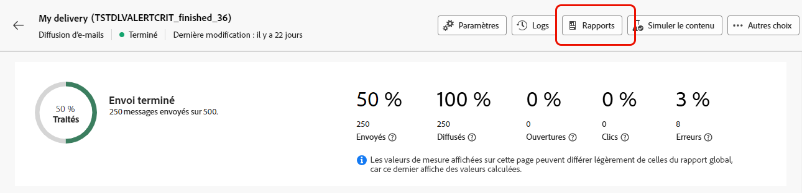

# Commencer avec les rapports dynamiques {#about-dynamic-reports}

Les rapports dynamiques fournissent des rapports entièrement personnalisables en temps réel. Ils offrent la possibilité d’accéder aux données de profil, ce qui permet l’analyse démographique par dimensions de profil, comme le genre, la ville et l’âge, en plus des données de campagne par e-mail fonctionnelles comme les ouvertures et les clics. Grâce à l’interface glisser-déposer, vous pouvez explorer les données, déterminer les performances de vos campagnes par e-mail par rapport à vos segments de clients les plus importants et mesurer leur impact sur les destinataires.

## Accès aux rapports dynamiques {#accessing-dynamic-reports}

Pour accéder aux rapports dans chaque campagne et diffusion, cliquez sur **Rapports**. Une fenêtre contextuelle s’affiche, vous informant d’une redirection vers la page **Rapport dynamique** dans un nouvel onglet du navigateur.

Certains rapports peuvent ne pas être immédiatement disponibles après une diffusion, selon le délai de collecte et de traitement des informations.

Les rapports dynamiques sont divisés en deux catégories :

* les **modèles**, qui peuvent être modifiés après avoir été copiés à l’aide de l’option **Enregistrer sous** (**Projet > Enregistrer sous.**) dans le modèle ;
* les **rapports personnalisés** (en bleu), qui peuvent être créés directement en cliquant sur le bouton **Créer un nouveau projet** sur la page d’accueil des **Rapports**.

