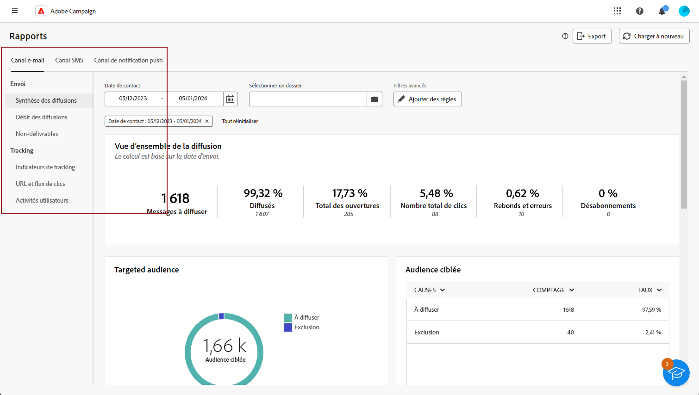
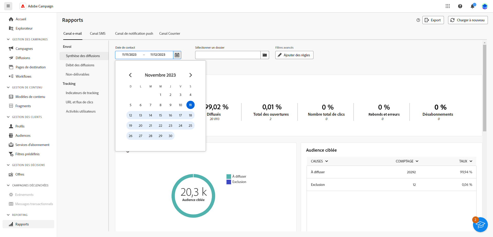
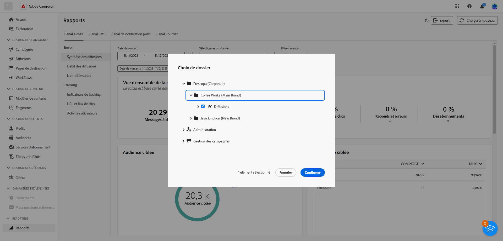

# Prise en main des rapports globaux {#global-report-gs}

>[!CONTEXTUALHELP]
>id="acw_campaign_reporting_global_report"
>title="Rapport global"
>abstract="Les rapports globaux offrent un moyen puissant et efficace d’analyser les performances de votre campagne. Ces rapports fournissent une vue consolidée des mesures clés du trafic et de l’engagement pour chaque canal de votre campagne."

Les **rapports globaux** constitue un outil efficace, offrant un résumé global consolidé des mesures de trafic et d’engagement pour chaque canal de votre instance Campaign. Ces rapports se composent de différents widgets, chacun offrant une perspective différente des performances de vos campagnes ou diffusions.

Les indicateurs clés de performance (KPI) sont actualisés toutes les heures, ce qui permet d’obtenir des informations à jour. Par défaut, les données sont filtrées pour couvrir les 30 derniers jours, offrant ainsi une perspective actuelle et pertinente sur les performances de vos campagnes et diffusions.

La liste complète des rapports et mesures associées pour chaque canal est disponible dans les pages suivantes :

* [Rapports globaux par e-mail](global-report-email.md)
* [Rapports globaux par SMS](global-report-sms.md)
* [Rapports globaux par notification push](global-report-push.md)
* [Rapports globaux sur le courrier](global-report-direct.md)

## Gérer votre tableau de bord des rapports {#manage-reports}

Pour accéder à vos rapports globaux et les gérer, procédez comme suit :

1. Accédez au menu **[!UICONTROL Rapports]** dans la section **[!UICONTROL Reporting]**.

1. Dans le menu de gauche, sélectionnez un rapport dans la liste et naviguez dans l’onglet pour afficher les données de chaque canal.

   {zoomable="yes"}

1. Dans votre tableau de bord, choisissez une **Heure de début** et une **[!UICONTROL Heure de fin]** pour cibler des données spécifiques.

   {zoomable="yes"}

1. Dans le champ **[!UICONTROL Sélectionner un dossier]**, choisissez si vous souhaitez cibler des diffusions ou des campagnes d’un dossier spécifique.

   {zoomable="yes"}

1. Cliquez sur **[!UICONTROL Ajouter des règles]** pour commencer à créer des requêtes afin de mieux filtrer les données de reporting. [Découvrir comment utiliser le concepteur de requête](../query/query-modeler-overview.md).

1. Dans **[!UICONTROL URL et flux de clics]**, choisissez **[!UICONTROL Liens les plus visités]** ou **[!UICONTROL Période]**.

   Les options **[!UICONTROL Afficher par]** permettent d’effectuer un filtrage sur des URL, des libellés ou des catégories.

## Rapports pour le canal LINE {#line-reports}

Les rapports disponibles pour le canal LINE sont décrits ci-dessous.

### Vue d’ensemble de la diffusion {#line-delivery-overview}

>[!CONTEXTUALHELP]
>id="acw_global_reporting_line_deliveries_overview"
>title="Présentation de la diffusion LINE"
>abstract="Affichez les messages à diffuser, les messages diffusés et les erreurs de diffusion pour LINE."

Le rapport **[!UICONTROL Présentation de la diffusion]** affiche les messages à diffuser, les messages diffusés et les erreurs de diffusion pour LINE.

### Audience ciblée {#line-targeted-audience}

>[!CONTEXTUALHELP]
>id="acw_global_reporting_line_targeted_audience"
>title="Audience ciblée LINE"
>abstract="Affichez l’audience ciblée par la diffusion LINE et les résultats de la diffusion qui en résultent."

Le graphique et le tableau **[!UICONTROL Audience ciblée]** affichent l&#39;audience ciblée par la diffusion LINE et les résultats de diffusion qui en résultent.

### Statistiques de diffusion {#line-delivery-stats}

>[!CONTEXTUALHELP]
>id="acw_global_reporting_line_delivery_stats"
>title="Statistiques de diffusion LINE"
>abstract="Affichez les résultats clés des diffusions pour les messages LINE, y compris les messages à diffuser, les messages diffusés et les erreurs de diffusion."

Le graphique et le tableau **[!UICONTROL Statistiques de diffusion]** affichent les principaux résultats de diffusion des messages LINE, y compris les messages à diffuser, les messages diffusés et les erreurs de diffusion.

### Causes d’exclusion {#line-exclusions}

>[!CONTEXTUALHELP]
>id="acw_global_reporting_line_exclusions"
>title="Causes d’exclusion LINE"
>abstract="Découvrez pourquoi les profils ciblés ont été exclus de la diffusion LINE, comme les règles d&#39;éligibilité, de validation ou de configuration."

Le graphique et le tableau **[!UICONTROL Causes d’exclusion]** indiquent les raisons pour lesquelles les profils ciblés ont été exclus de la diffusion LINE, telles que les règles d’éligibilité, de validation ou de configuration.

### Débit des diffusions {#line-delivery-throughput}

>[!CONTEXTUALHELP]
>id="acw_global_reporting_throughput_line"
>title="Débit de diffusion LINE"
>abstract="Affichez le taux d’envoi des messages LINE au fil du temps."

Le rapport **[!UICONTROL Débit de diffusion]** affiche le taux d’envoi des messages LINE au fil du temps.
