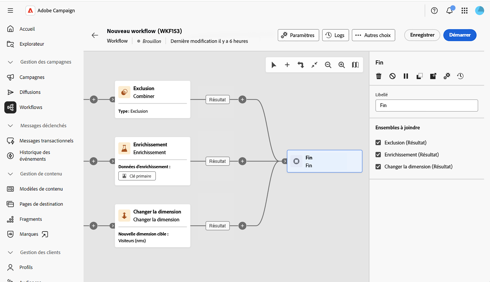

# Fin {#end}

>[!CONTEXTUALHELP]
>id="acw_orchestration_end"
>title="Activité Fin"
>abstract="L’activité **Fin** vous permet de marquer graphiquement la fin d’un workflow. Lorsque plusieurs transitions entrantes sont disponibles, utilisez la section **Ensembles à joindre** pour sélectionner celles à connecter à l’activité."

>[!CONTEXTUALHELP]
>id="acw_orchestration_end_sets"
>title="Ensembles à joindre"
>abstract="Sélectionnez les activités précédentes que vous souhaitez connecter en tant que transitions entrantes de l’activité **Fin**. Les activités sélectionnées sont ensuite connectées à l’activité **Fin**. Cette section s’affiche uniquement lorsque plusieurs transitions entrantes peuvent être connectées à l’activité."

>[!CONTEXTUALHELP]
>id="acw_orchestration_signal"
>title="Signal externe"
>abstract="Espace réservé pour la section de signal externe dans les paramètres d’activité de fin. Disponible uniquement pour les campagnes orchestrées. NE PAS SUPPRIMER"

L’activité **Fin** est une activité de **contrôle de flux**. Elle vous permet de marquer graphiquement la fin d’un workflow. Cette activité est facultative.

L’activité prend en charge plusieurs transitions entrantes lorsque plusieurs d’entre elles sont disponibles.

Dans la section **Ensembles à joindre**, cochez les activités précédentes que vous souhaitez connecter en tant que transitions entrantes de l’activité **Fin**. Les activités sélectionnées sont ensuite liées à l’activité **Fin** dans la zone de travail du workflow.

